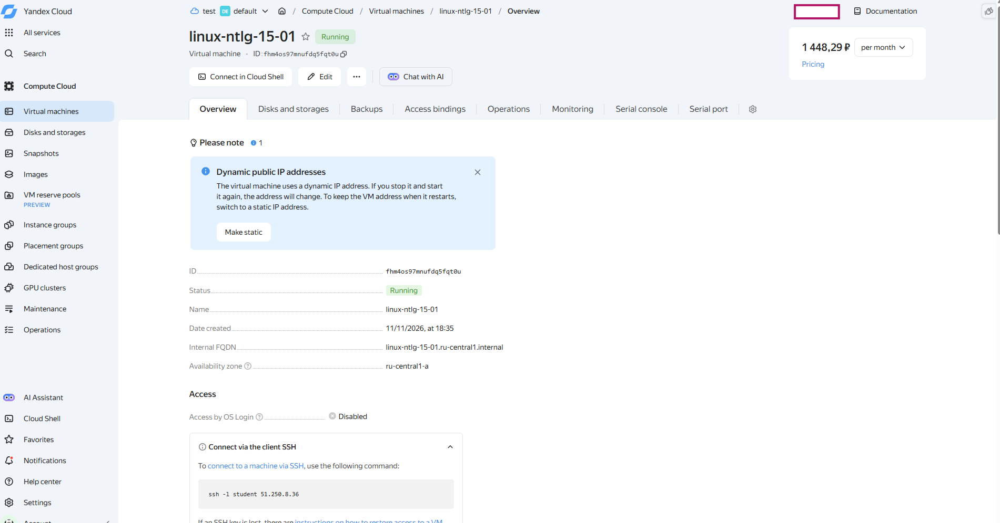
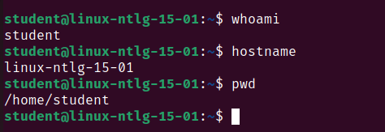
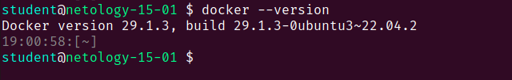
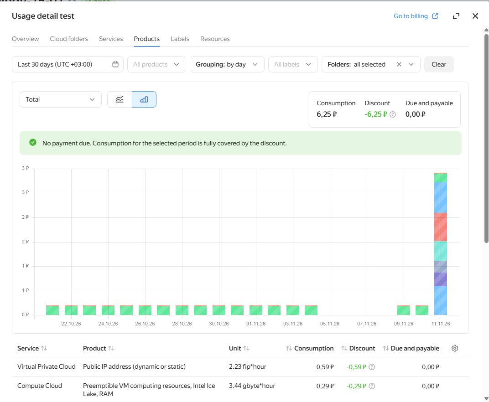

# Домашнее задание 15-01. Введение в виртуализацию

## Задание 1. Создание виртуальной машины в Yandex Cloud

### 1. Создание виртуальной машины

В Yandex Cloud создана виртуальная машина `netology-15-01` с использованием образа **Yandex Cloud Toolbox** из Cloud Marketplace.

Для подключения использована существующая сеть VPC `default` и подсеть `default-ru-central1-a`.

**Конфигурация виртуальной машины:**

| Параметр | Значение |
|---|---|
| Имя VM | netology-15-01 |
| Образ | Yandex Cloud Toolbox |
| ОС | Ubuntu 22.04 LTS |
| Платформа | Intel Ice Lake |
| Процессоры | 2 vCPU |
| Гарантированная производительность | 20% |
| Оперативная память | 2 GiB |
| Загрузочный диск | HDD, 30 GiB |
| Публичный IP | Динамический |
| Режим Preemptible | Включён |
| Cloud Backup | Отключён |
| Зона доступности | ru-central1-a |

**Скриншот 1. Созданная виртуальная машина:**



### 2. Подключение по SSH

Подключение выполнено из локальной виртуальной машины Ubuntu 22.04 (VirtualBox) с использованием SSH-ключа.

Команда подключения:

```bash
ssh -i ~/.ssh/ssh-key-netology-15-01/ssh-key-netology-15-01 student@62.84.127.145
```

Подключение выполнено успешно. Получен доступ к терминалу облачной VM под пользователем `student`.

**Скриншот 2. Успешное подключение по SSH:**



### 3. Проверка Docker

Для проверки Docker выполнена команда от имени root:

```bash
sudo docker --version
```

Результат:

```text
Docker version 29.1.3, build 29.1.3-0ubuntu3~22.04.2
```

Docker предустановлен в образе Yandex Cloud Toolbox.

**Скриншот 3. Проверка версии Docker:**



### 4. Предустановленные инструменты Yandex Cloud Toolbox

Согласно описанию образа в Yandex Cloud Marketplace, предустановлены следующие инструменты:

| Инструмент | Назначение |
|---|---|
| Yandex Cloud CLI | Управление ресурсами Yandex Cloud |
| Terraform | Автоматизация управления инфраструктурой |
| Packer | Создание образов виртуальных машин |
| Pulumi | Управление инфраструктурой с помощью кода |
| Docker | Создание и запуск контейнеров |
| Git | Контроль версий |
| Helm | Управление приложениями Kubernetes |
| kubectl | Управление ресурсами Kubernetes |
| gRPCurl | Выполнение запросов к gRPC-сервисам |
| jq | Обработка JSON |
| yq | Обработка YAML, JSON и XML |
| tree | Отображение структуры каталогов |
| tmux | Управление терминальными сессиями |


### 5. Прерываемая VM и анализ расходов

Виртуальная машина создана с включённым режимом **Preemptible**. Такая VM автоматически останавливается не позднее 24 часов после запуска.

Для анализа расходов открыт раздел **Yandex Cloud Billing → Детализация → По продуктам**.

На момент проверки (11.11.2026) за выбранный период 30 дней получены следующие данные:

Показатель - Сумма 

Потребление (Consumption) 6,25 руб 


В детализации отображаются расходы на вычислительные ресурсы VM, оперативную память, публичный IP-адрес и другие облачные ресурсы.

**Вывод:** использование прерываемой VM с производительностью CPU 20% позволяет снизить стоимость используемы мной вычислительных ресурсов. 


**Скриншот 4. Детализация расходов Yandex Cloud Billing:**




## Задание 2. Выбор платформы виртуализации

### 1. Высоконагруженная база данных MySQL, критичная к отказу

**Выбор: физические серверы.**

Причина выбора: Физический сервер обеспечивает прямой доступ к процессору, оперативной памяти и дискам без дополнительного слоя виртуализации.

Это важно для базы данных с высокой нагрузкой, где требуется максимальная производительность.

Для отказоустойчивости нужно использовать несколько серверов с репликацией данных. При отказе одного сервера работу продолжит другой.

### 2. Различные веб-приложения

**Выбор: виртуализация уровня ОС (контейнеризация).**

Веб-приложения удобно запускать в отдельных контейнерах Docker.

Контейнеры используют общее ядро операционной системы, поэтому потребляют меньше ресурсов, чем полноценные виртуальные машины.

Преимущества: быстрый запуск, изоляция приложений и удобное масштабирование.

### 3. Windows-системы для бухгалтерского отдела

**Выбор: паравиртуализация.**

Каждому сотруднику или группе сотрудников можно выделить отдельную виртуальную машину с Windows.

Это позволяет централизованно управлять машинами, устанавливать обновления и создавать бэкапы.

Паравиртуализированные драйверы помогают Windows эффективнее работать с виртуальным оборудованием.

### 4. Системы для высокопроизводительных расчётов на GPU

**Выбор: физические серверы.**

Для сложных вычислений требуется максимальная производительность видеокарт (GPU).

Физический сервер обеспечивает прямой доступ к GPU без дополнительных ограничений из-за виртуализации.

Такой вариант подходит для машинного обучения, обработки больших объёмов данных и различных  вычислений в большом объеме.


## Задание 3. Выбор системы управления виртуализацией

### 1. Инфраструктура из 100 виртуальных машин Linux и Windows

**Выбор: Microsoft Hyper-V.**

Hyper-V хорошо подходит для инфраструктуры, в которой преимущественно используется Windows.

Основные преимущества:
- Поддержка виртуальных машин Windows и Linux.
- Hyper-V Replica — репликация виртуальных машин на другой сервер.
- Failover Clustering — автоматическое переключение на другой сервер при отказе.
- Возможность настройки балансировки нагрузки и резервного копирования.

Выбор Hyper-V упрощает управление виртуальными машинами в Windows-инфраструктуре.

### 2. Бесплатная виртуализация 20–30 серверов Linux и Windows

**Выбор: KVM/QEMU.**

KVM — технология виртуализации, встроенная в ядро Linux. QEMU обеспечивает работу виртуального оборудования.

Преимущества:
- Бесплатное решение с открытым исходным кодом (open source).
- Высокая производительность благодаря аппаратной виртуализации.
- Поддержка Linux и Windows.
- Возможность управления через libvirt или Proxmox VE.

Подходит для небольшой серверной инфраструктуры без затрат на лицензии гипервизора.

### 3. Бесплатная виртуализация Windows-инфраструктуры

**Выбор: Microsoft Hyper-V.**

Hyper-V разработан Microsoft и обеспечивает хорошую совместимость с Windows.

Преимущества:
- Поддержка виртуальных машин Windows.
- Интеграция с инструментами Microsoft.
- Поддержка аппаратной виртуализации.
- Возможность создавать контрольные точки (checkpoints).

Hyper-V доступен как компонент Windows Pro и Windows Server. При этом сами операционные системы и гостевые Windows требуют соответствующих лицензий.

### 4. Тестирование программы на нескольких дистрибутивах Linux

**Выбор: Oracle VirtualBox.**

VirtualBox позволяет создавать несколько виртуальных машин с разными дистрибутивами Linux на одном компьютере.

Преимущества:
- Бесплатное использование основной платформы.
- Простой графический интерфейс.
- Возможность одновременного запуска нескольких VM.
- Снимки состояния (snapshots) для возврата к предыдущей конфигурации.

Подходит для разработки, тестирования и учебных задач.


## Задание 4. Проблемы гетерогенной среды виртуализации

Гетерогенная среда виртуализации — это инфраструктура, в которой одновременно используются разные системы виртуализации, например VMware, Hyper-V и KVM.

### Возможные проблемы и недостатки

1. **Сложное администрирование.** Для каждой системы нужны отдельные инструменты управления и настройки.
2. **Дополнительные расходы.** Увеличиваются затраты на лицензии, обслуживание и обучение специалистов.
3. **Проблемы совместимости.** Перенос виртуальных машин между разными платформами может потребовать конвертации дисков и изменения настроек.
4. **Сложность резервного копирования.** Необходимо обеспечить резервное копирование и восстановление для каждой платформы.
5. **Повышенные требования к безопасности.** Разные системы требуют отдельных настроек доступа, обновлений и контроля уязвимостей.

### Как минимизировать риски

- Использовать единые правила безопасности и управления доступом.
- Автоматизировать настройку инфраструктуры с помощью Ansible и Terraform.
- Организовать централизованный мониторинг, например через Zabbix.
- Настроить регулярное резервное копирование и проверять восстановление VM.
- Документировать конфигурацию каждой платформы.

### Мой выбор

Я бы предпочёл **однородную среду виртуализации**, построенную на одной платформе.

Это упрощает администрирование, снижает расходы на обслуживание и облегчает резервное копирование.

Гетерогенную среду имеет смысл использовать, если существуют конкретные технические требования, которые невозможно выполнить на одной платформе. Это скорее всего еди нственный фактор, который заставит исользовать гетерогенную среду. 
